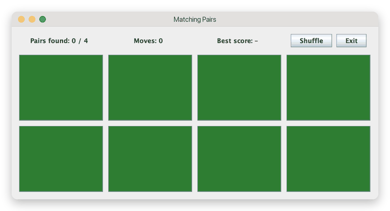
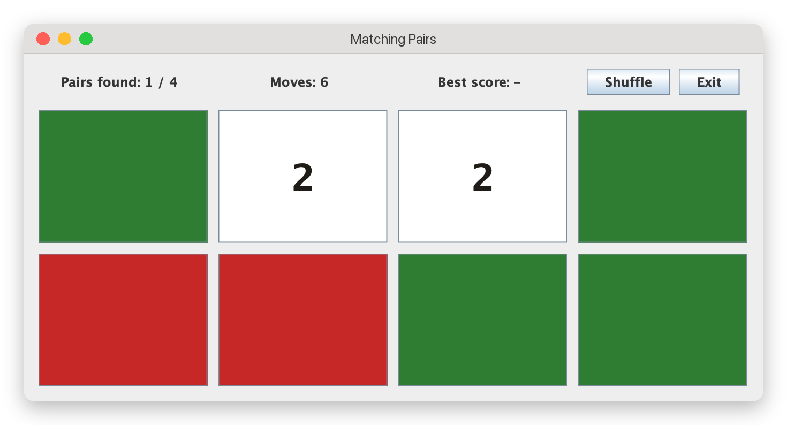
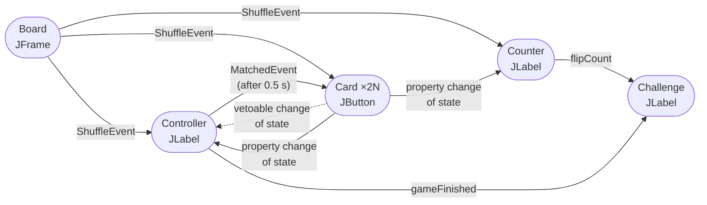
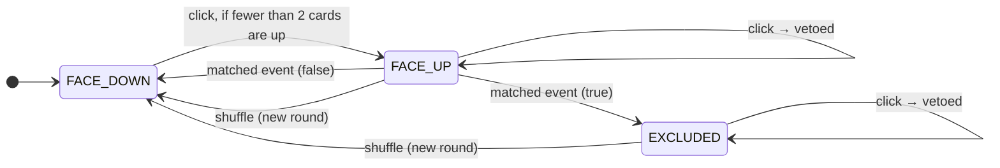
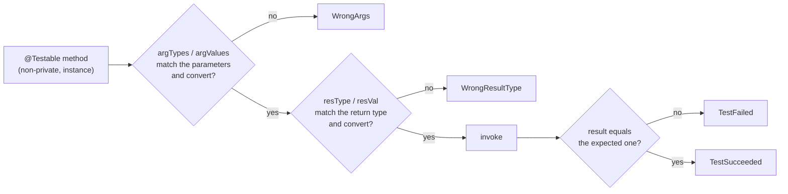

<div align="center">

# Advanced Programming

### Software components, reflection, functional types and metaprogramming in Java, Haskell and Python


[](LICENSE)

**4 assignments · 3 languages · every expected output reproduced byte for byte**

📄 **[Read the full report (PDF)](REPORT.pdf)** · [Quick start](#quick-start) · [Verifying the results](#verifying-the-results) · [Repository structure](#repository-structure)



</div>

---

**Author:** Giuseppe Muschetta<br>
**University:** University of Pisa<br>
**Degree:** M.Sc. in Data Science & Business Informatics<br>
**Course:** Advanced Programming (9 ECTS)<br>
**Academic year:** 2024–2025

---

Advanced Programming looks at what happens *behind* a programming language: how components are discovered and wired at run time, how a program can inspect its own classes, how a type system constrains what an abstraction can promise, and how a dynamic language can be extended with new behavior. This repository solves the four programming exercises of the course, one per idea, each in the language where the idea is most at home:

| | Part | Language | Idea | Result |
|:---:|:---|:---|:---|:---|
| **1** | [Matching Pairs game](#1--java-beans-the-matching-pairs-game) | Java · Swing | **Software components**: JavaBeans with bound and constrained properties, custom events, Observer pattern | Complete game + **both optional extensions**; one archive per bean |
| **2** | [RunTests](#2--java-reflection-and-annotations-unit-testing-with-arguments) | Java | **Reflection and annotations**: a unit-testing tool driven by `@Testable` and `@Specification` | Output **identical** to the 2 expected outputs |
| **3** | [Multisets](#3--haskell-multisets) | Haskell | **Algebraic data types and type classes**: a multiset type with `Eq` and `Foldable` instances | Both facts of the anagram test verified |
| **4** | [Type-checking decorators](#4--python-type-checking-decorators) | Python | **Metaprogramming**: decorators that enforce type hints at run time with `inspect` | All 3 logs (127 lines) reproduced **byte for byte** |

## What is in this repository

Each folder holds the solution of one exercise. Next to it, the repository keeps the files that came with the assignments, so that every result can be reproduced, and some documentation. **Every folder has its own README** that lists the role of each file and explains how to run and check it.

| Category | Files | What they are and why they are here |
|:---|:---:|:---|
| **Solution** | 21 | Exactly what the *solution format* of each exercise asks to deliver: the commented sources of the beans and one archive per bean; `RunTests.java` and the two annotations; `MultiSet.hs` and `TestMSet.hs`; `type_checking_decorators.py`. |
| **Provided with the assignments** | 15 | Included unchanged, because the solutions need them to run or to be checked: `Report.java` (`RunTests.java` does not compile without it), the two classes to test and their expected outputs; the four word lists read by `TestMSet.hs`; the three Python test programs and their logs. Anyone can therefore run the solutions and compare their output with the one expected by the assignments. |
| **Documentation** | 10 | This README, one README per folder, the [report](REPORT.pdf), the license and three images of the game. |

The archives of the beans end in `.raj` instead of `.jar`, as the course instructions require for submission: [why, and how to use them](#one-archive-per-bean-delivered-as-raj).

## Contents

- [What is in this repository](#what-is-in-this-repository)

- [Quick start](#quick-start)
- [1 · Java Beans: the Matching Pairs game](#1--java-beans-the-matching-pairs-game)
- [2 · Java Reflection and Annotations: unit testing with arguments](#2--java-reflection-and-annotations-unit-testing-with-arguments)
- [3 · Haskell: multisets](#3--haskell-multisets)
- [4 · Python: type-checking decorators](#4--python-type-checking-decorators)
- [Verifying the results](#verifying-the-results)
- [Repository structure](#repository-structure)
- [Report](#report)

## Quick start

**Requirements:** a JDK 17 or newer, GHC with `runghc`, Python 3.10 or newer.

```bash
git clone https://github.com/giuseppemuschetta/Advanced-Programming-Java-Haskell-Python.git
cd Advanced-Programming-Java-Haskell-Python
```

| Part | From the part's folder |
|:---|:---|
| 1 · Java Beans | `javac -d out src/*.java` then `java -cp out Board` |
| 2 · Reflection | `javac -d out src/*.java examples/*.java` then `java -cp out RunTests MathOpsTests` |
| 3 · Haskell | `runghc TestMSet.hs` |
| 4 · Python | `python3 test1.py` (also `test2.py`, `test3.py`) |

---

## 1 · Java Beans: the Matching Pairs game

> *Folder [`1-java-beans-matching-pairs`](1-java-beans-matching-pairs)*

The **Matching Pairs** game (also known as *Concentration*): eight cards lie face down, and the player turns two of them face up at every turn. A matching pair is removed from play; two different values are turned face down again. The goal of the exercise is not the game itself but its architecture: every component is a **JavaBean**, and the beans cooperate only through **events and listeners**, following the Publish–Subscribe (Observer) pattern.

<div align="center">

</div>

### The beans

| Bean | Extends | Properties | Listens to | Publishes |
|:---|:---|:---|:---|:---|
| **`Board`** | `JFrame` | | | `ShuffleEvent` (N values, each twice, in random order) |
| **`Card`** | `JButton` | `state` *bound + constrained*, `value` (read-only), `index` | `ShuffleEvent`, `MatchedEvent` | vetoable and property changes of `state` |
| **`Controller`** | `JLabel` | `pairsFound`, `gameFinished` (bound), `totalPairs` | vetoable + property changes of every card, `ShuffleEvent` | `MatchedEvent` (after 0.5 s), `gameFinished` |
| **`Counter`** | `JLabel` | `flipCount` (bound) | property changes of every card, `ShuffleEvent` | `flipCount` |
| **`Challenge`** | `JLabel` | `bestScore` (bound) | `flipCount` (Counter), `gameFinished` (Controller) | `bestScore` |



### The rules live in the veto

The `state` of a card is **constrained**: before every change the card fires a vetoable change event, and the `Controller` can reject it by throwing a `PropertyVetoException`. A click never decides on its own: it only *asks* for a change (a face-down card asks to turn face up; a face-up or excluded card asks to turn face down), and the `Controller` applies the rules:



| Requested change | Allowed when | Otherwise |
|:---|:---|:---|
| `FACE_DOWN → FACE_UP` | fewer than two cards are face up in the current turn | vetoed: the card stays down |
| `FACE_UP → EXCLUDED` / `FACE_UP → FACE_DOWN` | the `Controller` is delivering the matched event | vetoed: a face-up card cannot be turned down by clicking it |
| `EXCLUDED → FACE_DOWN` / `FACE_UP → FACE_DOWN` | a new round is starting after a shuffle | vetoed: an excluded card is out of play |

As the specification requires, **every** state change goes through `setState`, which fires the vetoable change, updates the card and then fires the bound property change. When all the cards are excluded, the veto leaves only *Shuffle* and *Exit* reactive.

### Design choices

- **One thread for everything.** The half-second delay before the matched event is a `javax.swing.Timer`, whose action runs on the Event Dispatch Thread like every click. No state is ever shared between threads, so no locking or `volatile` is needed.
- **Swing's own property support.** `JComponent` already implements bound and constrained properties (`firePropertyChange`, `fireVetoableChange`, `addVetoableChangeListener`); the beans use it instead of overriding Swing's listener methods, which would hijack the listeners that the look-and-feel itself registers.
- **A deterministic new round.** The `Board` notifies the `Controller` of a shuffle *before* the cards, so the `Controller` can authorize every card to turn face down again; a shuffle pressed during the half-second delay discards the pending turn.
- **Pure Observer wiring.** The `Challenge` never calls the `Counter`: it follows the `flipCount` property and reads it when `gameFinished` becomes true. The only getter call between beans is the `Controller` reading `getValue()` from the card that fired the event, as the specification describes ("it records its value").
- **Proper beans.** Every bean has a public no-argument constructor, is `Serializable` and exposes its properties through getters, so the JavaBeans `Introspector` sees them: it reports `Card.state` as bound **and** constrained.

### Optional extensions (both done)

1. **Parametric number of cards.** `Board` defines `N = 4` and uses `2 × N` cards everywhere; the other beans receive `N` at run time, so recompiling **only** `Board.java` with, say, `N = 6` gives a working game with 12 cards.
2. **Best score.** The `Challenge` label shows the smallest number of moves needed to complete a round since the game started.

### One archive per bean, delivered as `.raj`

The solution format asks for the commented source files and **one JAR archive for each bean**. The archives are in [`jars/`](1-java-beans-matching-pairs/jars) with the suffix **`.raj`**, because the course instructions ask to rename `.jar` files to `.raj` before sending them: Gmail, used to receive the solutions, filters out `.jar` attachments, even inside compressed archives. The repository keeps them exactly as they are delivered. To use them, rename them back to `.jar` (all of them, since each archive refers to the others by name):

```bash
cd 1-java-beans-matching-pairs/jars
for f in *.raj; do mv "$f" "${f%.raj}.jar"; done
java -jar Board.jar
```

Each archive declares its bean with the standard JavaBeans manifest entry and its dependencies with `Class-Path`. `Board.jar` is also executable:

```
Manifest-Version: 1.0
Main-Class: Board
Class-Path: Card.jar Controller.jar Counter.jar Challenge.jar

Name: Board.class
Java-Bean: True
```

`Card.jar` also contains the types shared by all the beans (`CardState`, the two events and their listeners), so each archive loads in a class loader that sees only itself and its `Class-Path`.

### Verified

During development the game was played automatically through the real `Board` (cards clicked with `doClick()`, window not shown): **43 checks** on the rules, including vetoed clicks, the half-second delay, a shuffle during the delay, the end of a round and the best score, all passed, with `N = 4` and again with `N = 6` after recompiling only the `Board`. Each archive was also loaded on its own, in a class loader that sees only that archive and its `Class-Path`.

---

## 2 · Java Reflection and Annotations: unit testing with arguments

> *Folder [`2-java-reflection-unit-testing`](2-java-reflection-unit-testing)*

`RunTests` is a small unit-testing tool. Given the name of a class, it loads it with the **Reflection API**, creates an instance, and invokes every non-private instance method annotated with `@Testable`, using the arguments and the expected result described by its `@Specification`:

```java
@Testable
@Specification(argTypes = {"int", "int"}, argValues = {"7", "3"}, resType = "int", resVal = "3")
public int testMin(int a, int b) { return (a < b) ? a : b; }
```

For each method it calls `Report.report(...)` (a class provided with the assignment, used unchanged) exactly once, with one of four outcomes:



In the first two cases the method is **never invoked**. Types correspond both to primitives and to their wrappers (`"int"` ↔ `int`/`Integer`, `"bool"` ↔ `boolean`/`Boolean`, ...); booleans must be written exactly `"true"` or `"false"`; a method that throws an exception is reported as `TestFailed`; a `@Testable` method without `@Specification` gets the default specification (no arguments, no result).

### Reading the declaration order from the bytecode

`Class.getDeclaredMethods()` returns the methods *"in no particular order"*, while the expected outputs list the tests in source order. Since `javac` writes the method table of a class file in declaration order, `RunTests` reads that table **directly from the `.class` file**: it scans the constant pool (all 17 constant kinds of the JVM specification), skips the interfaces and the fields, and numbers the methods as they appear, matching them to `Method` objects through their JVM descriptors (`testMin(II)I`). If the class file cannot be read, it falls back to sorting by name. The result is a deterministic output on every JVM.

### Verified

| Test class | Methods tested | Outcomes | Output vs expected |
|:---|:---:|:---|:---:|
| `MathOpsTests_simple` (provided) | 7 | 5 succeeded, 2 failed | **identical** |
| `MathOpsTests` (provided) | 11 | 5 succeeded, 2 failed, 2 wrong args, 2 wrong result type | **identical** |

Ten more cases were checked during development: protected and package-private methods, boxed types, `"42"` read as a double, a method that throws an exception, malformed booleans and numbers, an unknown type name, a `void` method with an expected value, and static and private methods, which are skipped.

```
==> Tests ready to run
=> Testing "hello" with args [] of type [] and result :...
=> "hello" tested with SUCCESS
=> Testing "testMin" with args [7, 3] of type [int, int] and result 3:int...
=> "testMin" tested with SUCCESS
=> Testing "testMin1" with args [7, 3] of type [int, int] and result 7:int...
=> "testMin1" tested but FAILED
```

---

## 3 · Haskell: multisets

> *Folder [`3-haskell-multisets`](3-haskell-multisets)*

A **multiset** (or bag) is a collection where order does not count but elements can repeat. The module `MultiSet` implements it on the concrete representation required by the assignment, a list of `(element, multiplicity)` pairs, using only the Prelude:

```haskell
data MSet a = MS [(a, Int)]
  deriving (Show)
```

An `MSet` is **well-formed** when every multiplicity is positive and no element appears twice; every operation that returns an `MSet` preserves this invariant.

| Function | Type | Meaning |
|:---|:---|:---|
| `empty` | `MSet a` | the empty multiset |
| `add` | `Eq a => MSet a -> a -> MSet a` | one more occurrence of an element |
| `occs` | `Eq a => MSet a -> a -> Int` | multiplicity of an element |
| `elems` | `MSet a -> [a]` | all the elements, with repetitions |
| `subeq` | `Eq a => MSet a -> MSet a -> Bool` | inclusion, multiplicities included |
| `union` | `Eq a => MSet a -> MSet a -> MSet a` | sum of the multiplicities |
| `mapMSet` | `Eq b => (a -> b) -> MSet a -> MSet b` | map, merging elements with the same image |
| `instance Eq (MSet a)` | | same elements with the same multiplicities, in any order |
| `instance Foldable MSet` | `foldr` | folds over the elements **ignoring the multiplicities** |

The type signatures are exactly those inferred by GHC (checked by removing them and asking GHCi).

**Why `MSet` cannot be a `Functor`.** `fmap` must have type `(a -> b) -> MSet a -> MSet b` for **every** `b`, but keeping the result well-formed requires merging the elements that `f` maps to the same value, and therefore comparing values of type `b`: `mapMSet` needs the constraint `Eq b`, which the class `Functor` cannot express. An `fmap` without the merge would break the invariant: `fmap (const 0) (MS [(1,1),(2,1)])` would be `MS [(0,1),(0,1)]`.

### The anagram test (`TestMSet.hs`)

`readMSet` reads a file and builds the multiset of the **ciao** of its words (*characters in alphabetical order*: `ciao "Hello" = "ehllo"`), so anagrams fall into the same element; `writeMSet` writes one `<elem> - <multiplicity>` per line. On the four files provided with the assignment:

```
Multisets of ciao strings
  m1  aux_files/anagram.txt     870   words, 245 distinct ciao
  m2  aux_files/anagram-s1.txt  450   words, 208 distinct ciao
  m3  aux_files/anagram-s2.txt  420   words, 198 distinct ciao
  m4  aux_files/margana2.txt    1740  words, 245 distinct ciao

Facts
  (i)  m1 == m4                                 False
    => m1 and m4 are not equal...
       m1 and m4 have the same elements         True
    => ...but they have the same elements: the same anagram classes, with different multiplicities.
  (ii) m1 == union m2 m3                        True
    => m1 is equal to the union of m2 and m3.
```

### Beyond the anagram test

During development, 17 laws of the type were also checked **exhaustively** on every multiset built from the 121 lists over `"abc"` of length 0 to 4, on all their 14,641 pairs and on 2,197 triples: well-formedness, `occs`, `elems`, equality up to order, `subeq`, `union` (sum of multiplicities, commutativity, associativity, identity), `Foldable` visiting each element once, `mapMSet` merging colliding images: **76,494 cases, 0 failures**.

---

## 4 · Python: type-checking decorators

> *Folder [`4-python-type-checking-decorators`](4-python-type-checking-decorators)*

Python ignores type hints at run time. The assignment tells the story of a lecturer whose module of type-checking decorators was lost, leaving only three test files and their logs: the task is to rewrite the three decorators so that the tests produce the same output again. They use the reflection facilities of the `inspect` module:

| Decorator | Behavior |
|:---|:---|
| `@print_types` | prints the type hint and the actual value (with its type) of every argument and of the result |
| `@type_check` | prints only the disagreements between values and type hints, identifying parameters by position |
| `@bb_type_check(max_block)` | *bounded-blocking*: a call with a wrong argument is **blocked** (not invoked, returns `None`) at most `max_block` times; afterwards the function runs and its result is checked |

```text
>>> @bb_type_check(2)
... def add(x: int, y: float) -> str:
...     return x + y
>>> add(2.3, 2.3)
Parameter '0' has value '2.3', not of type '<class 'int'>'
Function blocked. Remaining blocks: 1
>>> add(2.3, 2.3)
Parameter '0' has value '2.3', not of type '<class 'int'>'
Function blocked. Remaining blocks: 0
>>> add(2.3, 2.3)
Parameter '0' has value '2.3', not of type '<class 'int'>'
Result is '4.6', not of type '<class 'str'>'
4.6
```

**Implementation notes.** The signature is computed once, when the function is decorated, not at every call; `bb_type_check` is a decorator *factory* whose counter of remaining blocks lives in a closure (`nonlocal`); union hints such as `int | str` and the `-> None` hint are handled; a hint that cannot be checked at run time (a string or a parameterized generic) is skipped instead of raising an error.

**Verified:** `python3 testN.py` reproduces `logN.txt` **byte for byte** for N = 1, 2, 3 (Python 3.10 or newer, which accepts union hints written `X | Y`).

---

## Verifying the results

Whenever an assignment provides an expected output, the solution reproduces it exactly, and anyone can check it with `diff`, which prints nothing when two outputs are identical:

```bash
# 2 · Reflection: compare with the expected outputs provided with the assignment
cd 2-java-reflection-unit-testing
javac -d out src/*.java examples/*.java
java -cp out RunTests MathOpsTests | diff - expected/RunTests_MathOpsTests.output && echo identical
```

```bash
# 4 · Python: each log starts with the command line, followed by the output
cd 4-python-type-checking-decorators
python3 test1.py | diff - <(tail -n +2 log1.txt) && echo identical
```

| Part | What was verified | Result |
|:---|:---|:---|
| 1 · Java Beans | 43 game rules through the real `Board`, with `N = 4` and `N = 6`; each archive loaded on its own | all passed |
| 2 · Reflection | `RunTests` on the two provided classes, compared with the expected outputs | 2 / 2 identical |
| 3 · Haskell | compilation with `ghc -Wall -Werror`; the two facts of the anagram test; 17 laws on 76,494 cases | all passed |
| 4 · Python | the three test programs, compared with the three logs | 3 / 3 identical |

## Repository structure

```
Advanced-Programming-Java-Haskell-Python/
├── README.md                                   documentation
├── REPORT.pdf                                  documentation: full technical report
├── LICENSE
├── 1-java-beans-matching-pairs/
│   ├── README.md                               the role of every file
│   ├── src/                                    solution: Board, Card, Controller, Counter, Challenge,
│   │                                           CardState, ShuffleEvent/Listener, MatchedEvent/Listener
│   ├── jars/                                   solution: one archive per bean, delivered as .raj
│   └── docs/                                   documentation: screenshots and animation
├── 2-java-reflection-unit-testing/
│   ├── README.md
│   ├── src/                                    solution: RunTests, Testable, Specification
│   │                                           provided: Report
│   ├── examples/                               provided: MathOpsTests, MathOpsTests_simple
│   └── expected/                               provided: expected outputs
├── 3-haskell-multisets/
│   ├── README.md
│   ├── MultiSet.hs                             solution (exercise 1)
│   ├── TestMSet.hs                             solution (exercise 2)
│   └── aux_files/                              provided: the four word lists
└── 4-python-type-checking-decorators/
    ├── README.md
    ├── type_checking_decorators.py             solution
    └── test1.py … test3.py, log1.txt … log3.txt   provided: tests and logs
```

The files provided with the assignments are included unchanged (the comments of the two Java test classes are in Italian, as distributed). The MIT license applies to the solution and to the documentation; the provided files belong to the course.

## Report

📄 **[REPORT.pdf](REPORT.pdf)** describes the four parts in depth: the bean architecture and its event flow, the veto rules and the threading model, the reflection pipeline and the class-file parsing, the multiset type with its invariant and laws, the decorators and the `inspect` machinery, and how each part was verified.

## Author

**Giuseppe Muschetta** · [giuseppemuschetta.com](https://giuseppemuschetta.com) · [LinkedIn](https://www.linkedin.com/in/giuseppemuschetta) · [GitHub](https://github.com/giuseppemuschetta)

Released under the [MIT License](LICENSE).
